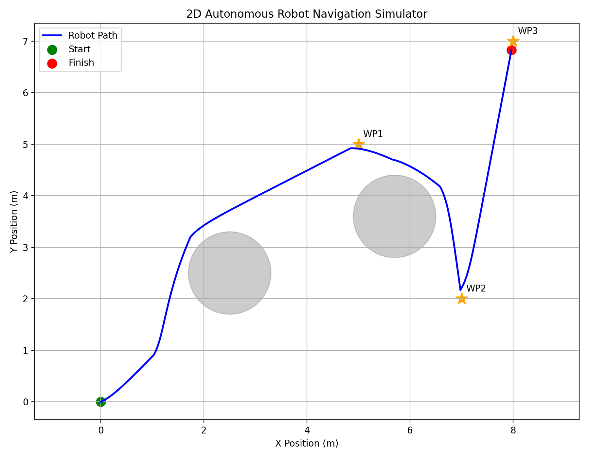

# 2D Autonomous Robot Navigation Simulator

A standalone C++17 project that simulates a mobile robot navigating through multiple waypoints while detecting and avoiding circular obstacles.

## Features

- 2D robot motion using position (x, y) and orientation (yaw)
- Linear and angular velocity control
- Automatic waypoint navigation using distance and heading calculations
- Simulated obstacle detection and reactive avoidance
- Collision prevention checks
- Trajectory recording in CSV format
- Python-based trajectory visualization
- Automated tests for waypoint completion and collision checking

## Technologies

- C++17
- Object-Oriented Programming
- Robot Kinematics
- Basic Feedback Control
- Python 3
- Matplotlib
- Git and GitHub

## Project Structure

```text
cpp-autonomous-robot-simulator/
├── robot_sim.cpp
├── plot_trajectory.py
├── test_robot.py
├── trajectory.png
├── README.md
└── .gitignore
```

## How to Run

Compile the C++ simulator:

```bash
g++ -std=c++17 -Wall -Wextra robot_sim.cpp -o robot_sim
```

Run the simulation:

```bash
./robot_sim
```

Generate the trajectory plot:

```bash
python3 plot_trajectory.py
```

Run automated tests:

```bash
python3 test_robot.py
```

## Simulation Results

The robot successfully navigated through three target waypoints:

1. (5, 5)
2. (7, 2)
3. (8, 7)

Final recorded position: approximately (7.97, 6.83).

All automated tests passed for the default scenario, including waypoint completion and collision checking.

## Visualization



## Limitations

The simulator uses a simplified point-robot model and reactive obstacle avoidance. It does not currently implement global path planning, realistic sensor noise, differential-drive wheel dynamics, or a physical simulation engine.

## Future Improvements

- A* path planning
- PID-based heading control
- Differential-drive robot kinematics
- Dynamic obstacle avoidance
- ROS 2 integration
